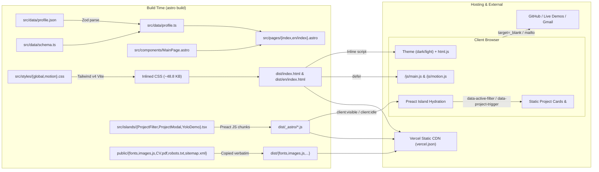

# System Architecture — `robertus-portfolio`

## 1. Purpose & Scope

This repository hosts the active **Astro + Preact + Tailwind CSS v4** static portfolio site, its bilingual (`id`/`en`) data pipeline (`src/data/projectCatalog.ts`), selectively hydrated Preact islands (plus lazy `motion/mini`), static deployment on Vercel, and remaining legacy artifacts.

---

## 2. System Overview

`robertus-portfolio` is a static, bilingual (Indonesian default `/`, English `/en`) personal portfolio website for Robertus William Susanto. At build time (`astro build`), Astro compiles `.astro` components and validates `src/data/profile.json` against a Zod schema (`src/data/schema.ts`), unifying public project specs via `src/data/projectCatalog.ts` to emit two self-contained static HTML pages (`dist/index.html` and `dist/en/index.html`) with inlined CSS (`inlineStylesheets: 'always'`). Client-side interactivity is split between deferred vanilla JS scripts (`public/js/main.js`, `public/js/motion.js`), on-demand helpers (`src/lib/{lazyMotion,commandPalette}.ts`), and six selectively hydrated Preact islands (`HeroFocusConsole`, `ProjectFilter`, `CipherPreview`, `YoloDemo`, `ProjectModal`, `CommandPalette`).

### Active Tech Stack (Verified Against `package-lock.json`)

| Layer | Technology | Declared (`package.json`) | Locked (`package-lock.json`) | Role |
| --- | --- | --- | --- | --- |
| Static Framework | Astro | `^7.4.1` | `7.4.1` | Static HTML compilation & i18n routing (`src/pages/`) |
| Interactive Islands | Preact + `@astrojs/preact` | `^11.0.1` / `^6.1.0` | `11.0.1` / `6.1.0` | Selective hydration (`client:visible`, `client:idle`) |
| Lazy Motion Engine | `motion` (`motion/mini`) | `14.12.0` | `14.12.0` | Lazy-imported WAAPI micro-choreography (MIT) |
| Styling | Tailwind CSS + `@tailwindcss/vite` | `^4` / `^4.3.3` | `4.2.1` / `4.3.3` | Design tokens (`@theme`) & utility CSS |
| Schema Validation | Zod | `^4.6.7` | `4.6.7` | Build-time validation of `src/data/profile.json` |
| Type Checking | TypeScript | `^5` | `5.9.3` | Strict TS config (`astro/tsconfigs/strict`) |
| Runtime / Pkg Mgr | Node.js / npm | `—` | `v24.14.0` / `11.9.0` | Local build & script execution |
| Hosting / CDN | Vercel | `—` | `—` | Static hosting (`dist/`) & HTTP headers (`vercel.json`) |
| Audit & QA Tools | Puppeteer Core, Lighthouse, Pixelmatch, PNGJS | `^25.14.0`, `^13.5.0`, `^8.0.0`, `^7.0.0` | `25.14.0`, `13.5.0`, `8.0.0`, `7.0.0` | Headless Chrome functional, parity & perf gates |

> **Legacy / Unused Packages in `package.json`**: `next` (`16.1.6`), `react` (`19.2.3`), `react-dom` (`19.2.3`), `framer-motion` (`12.35.2`), `lucide-react` (`0.577.0`), `react-simple-typewriter` (`5.0.1`), `eslint` (`9.39.4`), `eslint-config-next` (`16.1.6`), `@tailwindcss/cli` (`4.3.3`), `@tailwindcss/postcss` (`4.2.1`), `@types/node` (`20.19.37`), `@types/react` (`19.2.14`), `@types/react-dom` (`19.2.3`). None are imported by `src/`.

---

## 3. High-Level Diagram

---

## 4. Annotated Directory Tree

| Path | Purpose | Consumers / Status |
| --- | --- | --- |
| `src/pages/` | File-based routes: `index.astro` (`lang="id"`), `en/index.astro` (`lang="en"`) | Entrypoints for `astro build` |
| `src/layouts/BaseLayout.astro` | HTML shell, SEO/OG/Twitter/JSON-LD, font preload, inline anti-FOUC theme script, skip link, deferred scripts | Imported by `MainPage.astro` |
| `src/components/` | 16 zero-JS `.astro` sections/partials (incl. `ProjectPeek.astro`, `ArchitectureStrip.astro`) + `MainPage.astro` + `ChatbotMount.astro` | Imported by `MainPage.astro`, `Navbar.astro`, `Projects.astro` |
| `src/islands/` | 6 Preact `.tsx` interactive islands (`HeroFocusConsole`, `ProjectFilter`, `CipherPreview`, `YoloDemo`, `ProjectModal`, `CommandPalette`) | Hydrated in `Hero.astro`, `Projects.astro`, and `MainPage.astro` |
| `src/lib/` | Lazy-loaded utilities (`lazyMotion.ts`, `commandPalette.ts`) | Dynamically imported on interaction; 0 B before LCP |
| `src/data/` | `profile.json`, `schema.ts` (Zod), `profile.ts` (`ProfileSchema.parse`, `getLocalized`), `projectCatalog.ts` (`getPublicProjectCatalog`) | Imported by `BaseLayout`, `Hero`, `Projects`, `Experience`, `Skills`, `Education`, `MainPage` |
| `src/styles/` | `global.css` (Tailwind v4 + `@font-face` + `@theme` tokens), `motion.css` (animations + filter rules); `input.css` (legacy CLI CSS) | `global.css` imported by `BaseLayout.astro`; `input.css` only used by `legacy:*` scripts |
| `src/js/` | Leftover copies of `motion.js` and `theme.js` | **Unused** (duplicated in `public/js/`) |
| `public/` | Static assets copied directly to `dist/`: `fonts/`, `images/`, `js/{main,motion,theme}.js`, `CV.pdf`, `robots.txt`, `sitemap.xml`, legacy `css/style.css`, unused Next.js SVGs, uncompressed JPG/PNGs | Served from `/` by Astro & Vercel (`theme.js` unused) |
| `api/` | `api/README.md` reserving future Vercel serverless functions (e.g., AI chatbot) | Reserved; no active `.ts`/`.js` endpoints |
| `docs/` | Technical documentation (`AGENT.md`, `ARCHITECTURE.md`, `AUDIT_REPORT.md`, `DECISION_REPORT.md`) | Human & AI onboarding/audit docs; zero runtime coupling |
| `tests/` | `test-functional.mjs`, `test-content-parity.mjs`, `test-motion-budgets.mjs` (`npm run test:motion`), fixtures & allowlist | Executed via `node tests/...` and `npm run test:motion` |
| `scripts/` | 16 `.js`/`.mjs` QA, Lighthouse, visual-diff, fixture-generation, and legacy-build scripts | Executed manually; not wired into `npm test` |
| `app/`, `components/` | Leftover Next.js 16 App Router pages (`layout.tsx`, `page.tsx`, `robots.ts`, `sitemap.ts`) and React components | **Dead code** (unused by Astro build) |
| `_legacy/` | Archived pre-Astro static HTML/CSS/JS site (`_legacy/index.html`) | **Archived reference** used by `scripts/generate-snapshot-fixture.mjs` |
| `images/`, `fonts/`, root `CV.pdf`, `favicon.ico`, `robots.txt`, `sitemap.xml` | Pre-migration root static assets | **Dead duplicates** of `public/` (`sitemap.xml` stale at `2026-10-20`) |
| `dist/`, `.astro/`, `.next/`, `screenshots/`, `reference/` | Generated build outputs, caches, and visual-regression artifacts (gitignored) | Generated locally |

---

## 5. Rendering & Routing Model

- **Static Generation (`output: 'static'`)**: `astro.config.mjs:7` builds all pages at compile time into `dist/`. No SSR server or middleware runs in production.
- **i18n Routing**: `astro.config.mjs:11-17` sets `defaultLocale: 'id'`, `locales: ['id', 'en']`, `prefixDefaultLocale: false`.
  - `/` -> `src/pages/index.astro` -> `<MainPage lang="id" />` -> `dist/index.html` (`<html lang="id">`).
  - `/en` -> `src/pages/en/index.astro` -> `<MainPage lang="en" />` -> `dist/en/index.html` (`<html lang="en">`).
- **Vercel URL Handling**: `vercel.json:6-7` configures `"cleanUrls": true` and `"trailingSlash": false`, matching canonical/hreflang URLs (`/` and `/en`).
- **In-Page Navigation**: Header, mobile drawer, and bottom nav link to section anchors (`#about`, `#projects`, `#experience`, `#skills`, `#education`, `#contact`). Language switcher links preserve `window.location.hash` via inline `onclick` (`Navbar.astro:57,70`).

---

## 6. Component Architecture

- **Layout Shell**: `MainPage.astro` wraps all sections in `BaseLayout.astro`, passing `lang`, `pageTitle`, and `pageDesc`.
- **Static `.astro` Sections (Zero Client JS)**: `Navbar` (with `#cmd-palette-open` fallback link), `ThemeToggle`, `MobileDrawer`, `Hero`, `About`, `Projects` (embeds `ProjectPeek.astro` native `
` specs on all 6 cards + `ArchitectureStrip.astro` data-flow strips on Cards `2, 4, 5, 6`), `Experience`, `Skills`, `Education`, `Contact`, `Footer`, `BottomNav`, `ChatbotMount` (empty `hidden` mount point).
- **Hydrated Preact Islands (`src/islands/`)**:
  - `HeroFocusConsole.tsx` (`client:idle` in `Hero.astro`): Interactive AI / Full-Stack focus switcher (`role="tablist"` + WAI-ARIA `ArrowLeft`/`ArrowRight`/`Home`/`End`), rendered statically via SSR so JS-off keeps the panel visible.
  - `ProjectFilter.tsx` (`client:visible` in `Projects.astro`): Computes domain counts dynamically from `[data-domain]` cards, slides a compositor `translate3d`/`scaleX` `.filter-indicator-pill`, runs `motion/mini` FLIP card transitions on interaction, listens for `ProjectPeek` `
` toggles, hides non-matching cards (`hidden` + `inert` + `aria-hidden="true"`), and announces filtered counts via `aria-live="polite"`.
  - `CipherPreview.tsx` (`client:visible` inside Card 3): Interactive classical-cipher sandbox (`role="radiogroup"` for Caesar/Vigenere/Affine with `[Edit Text]` lazy `<input>` trigger to keep initial TBT near zero).
  - `YoloDemo.tsx` (`client:visible` in `Projects.astro`): Interactive drag/keyboard (`ArrowLeft`/`ArrowRight`) comparison slider using `clipPath: inset(0 0 0 ${sliderPos}%)` over two `<picture>` layers of `/project-ai.jpg`.
  - `ProjectModal.tsx` (`client:idle` in `MainPage.astro`, receives `catalog={projectCatalog}`): Attaches a global `document` click listener for `[data-project-trigger]` attributes (`yolo`, `sibarista`, `kriptografi`, `portfolio`, `expense-tracker`, `partsbin`), opens `<dialog>` (`backdrop:bg-black/85`, no fullscreen backdrop blur) via `showModal()`, renders WAI-ARIA APG `Overview`/`Architecture`/`Stack` tabs with `lazyAnimate`, traps `Tab`/`Shift+Tab`, restores trigger focus on close, and animates via `@starting-style` + `transition-behavior: allow-discrete` (`[UNVERIFIED on Safari/Firefox]`).
  - `CommandPalette.tsx` (`client:idle` in `MainPage.astro`, returns `null`): Prefetches `src/lib/commandPalette.ts` on pointer/focus of `#cmd-palette-open` and mounts an on-demand `<dialog>` command palette on click or `Ctrl/Cmd+K`, deriving project entries from `#projects-grid` DOM cards to avoid duplicating JSON in HTML.
- **Cross-Cutting DOM Controllers (`public/js/`)**:
  - `main.js`: Exposes `window.openDirectEmail` and `window.copyEmailAddress` (updates `#clipboard-live` `aria-live`, toggles checkmark icon, syncs `aria-label` in copied state); binds `.theme-toggle-btn` (progressive `document.startViewTransition` crossfade, `[UNVERIFIED on Safari/Firefox]`), mobile drawer, and `IntersectionObserver` active-nav highlighting with `translate3d`/`scaleX` indicators (`#desktop-nav-indicator`, `#bottom-nav-indicator`) measured lazily on `load`/`fonts.ready`/`resize`.
  - `motion.js`: Checks `prefers-reduced-motion` (`html.reduced-motion`), runs `.scroll-reveal` `IntersectionObserver` fallback ONLY when `!CSS.supports('animation-timeline', 'view()')`, runs scroll progress `scaleX` fallback ONLY when `!CSS.supports('animation-timeline', 'scroll()')`, pauses `.status-dot-pulse` off-viewport, drives card cursor spotlight (`--mouse-x`/`--mouse-y`), and animates `#yolo-precision-counter` (`0%` -> `90%`).

---

## 7. Data & Content Flow

1. **Canonical Structured Data (`src/data/profile.json`)**: Stores bilingual `{ id, en }` strings, `public: boolean` flags, identity, summary, 1 education entry, 6 projects, 4 experiences, 6 skill categories, 6 certifications (including Google Cloud Computing Foundations Certificate), and 5 links.
2. **Validation & Unified Project Catalog (`src/data/schema.ts`, `src/data/profile.ts`, `src/data/projectCatalog.ts`)**: `ProfileSchema.parse(profileJson)` validates JSON at Astro build time; `getPublicProjectCatalog(lang)` merges `profile.json` project entries with technical specs so `Projects.astro` cards, `ProjectPeek`, and `ProjectModal` share a single source (`F-007` partially resolved).
3. **Remaining Component Consumption (`F-007` follow-up)**:
   - **Reads from `profile.ts` / `projectCatalog.ts`**: `BaseLayout`, `Hero`, `Education`, `Experience`, `Skills`, `Projects` (Cards 1–6 via `projectCatalog`), `ProjectPeek`, `ProjectModal` (`catalog` prop).
   - **Still hardcoded in components**: `About.astro` (all text), `Experience.astro` (tag pills), `Skills.astro` (skill items), `CommandPalette` section list (`commandPalette.ts`), and email/social URLs.
   - Note: `public: boolean` in `schema.ts` is **not** filtered at runtime/build time by `profile.ts` selectors.

---

## 8. State Management

No global state library (Redux/Zustand/Nano Stores) is used. State is localized to:
- **Theme Preference**: Persisted in `localStorage.getItem('theme')` (`'light'` | `'dark'`) and mirrored onto `document.documentElement.classList` (`BaseLayout.astro:88-107`, `public/js/main.js:56-70`).
- **UI Island State**: `ProjectFilter` (`active: string`), `ProjectModal` (`selectedId: string | null` + `document.body.style.overflow`), `YoloDemo` (`sliderPos: number`, `isDragging: boolean`).
- **DOM Attribute Bridge**: `ProjectFilter` communicates with static Astro `<article>` cards by mutating `#projects-grid[data-active-filter]`; Astro triggers communicate with `ProjectModal` via `[data-project-trigger]` DOM attributes.

---

## 9. Styling & Design System

- **Tailwind CSS v4**: Loaded via `@tailwindcss/vite` (`astro.config.mjs:20`) and `@import "tailwindcss";` (`src/styles/global.css:1`). `build.inlineStylesheets: 'always'` embeds `48,804 B` of compiled CSS into `<style>` tags inside each HTML file.
- **Design Tokens (`src/styles/global.css:22-102`)**:
  - **Dark Theme (`:root`, default)**: `--surface: #131313`, `--surface-container-lowest: #0e0e0e`, `--surface-container-low: #1c1b1b`, `--surface-container: #201f1f`, `--surface-container-high: #2a2a2a`, `--primary: #ffffff`, `--on-surface: #e5e2e1`, `--on-surface-variant: #c4c7c9`, `--outline: #8e9193`, `--secondary: #34d399` (emerald accent), `--dot-color: rgba(255, 255, 255, 0.045)`.
  - **Light Theme (`html.light`)**: `--surface: #f8f9fa`, `--surface-container-low: #f1f3f5`, `--primary: #121212`, `--on-surface: #1a1a1a`, `--secondary: #059669`, `--dot-color: rgba(18, 18, 18, 0.06)`.
  - **Motion Tokens (`:root`)**: `--duration-instant: 100ms`, `--duration-fast: 150ms`, `--duration-base: 250ms`, `--duration-slow: 500ms`, `--duration-hero: 650ms`, `--ease-standard: cubic-bezier(0.22, 1, 0.36, 1)`, `--ease-decelerate: cubic-bezier(0, 0, 0.2, 1)`, `--ease-accelerate: cubic-bezier(0.4, 0, 1, 1)`, `--stagger-step: 60ms`, `--motion-distance-sm: 8px`, `--motion-distance-md: 16px`.
  - **Typography**: `'Geist'` (`--font-sans`, `/fonts/geist-latin.woff2`) and `'JetBrains Mono'` (`--font-mono`, `/fonts/jetbrains-mono-latin.woff2`).
- **Responsive Breakpoints**: Standard Tailwind breakpoints (`sm` 640px, `md` 768px, `lg` 1024px) inside `max-w-[1280px]` containers; mobile uses `BottomNav` + `MobileDrawer` below `lg`, desktop uses top `#desktop-nav` at `lg+`.
- **Motion System (`src/styles/motion.css`)**: Implements E1 hero word slide, E2 pulsing availability dot (paused offscreen/hover/focus), E3 mono typing via compositor `clip-path`, E4 mutually exclusive `animation-timeline: view()` / IO scroll reveals (`[UNVERIFIED on Safari/Firefox]`), E5 scroll progress bar (`scroll()` + rAF fallback), `.btn-interactive` & `.skill-chip` states, `.nav-indicator` `translate3d`/`scaleX`, `<dialog>` `@starting-style` (`[UNVERIFIED on Safari/Firefox]`), View Transition theme crossfade (`[UNVERIFIED on Safari/Firefox]`), and consolidated `prefers-reduced-motion: reduce` overrides.

---

## 10. Build, Environments & Deployment

- **Environment Variables**: None required or referenced in `src/` or `vercel.json`. `.env*` is gitignored (`.gitignore:22-23`).
- **Build Pipeline (`npm run build` -> `astro build`)**:
  1. Generates `.astro/types.d.ts` (`742ms` in verification run).
  2. Compiles Astro pages and bundles Preact islands via Vite (`dist/_astro/*.js`).
  3. Compiles and inlines Tailwind + `motion.css` into HTML.
  4. Copies `public/` verbatim to `dist/`.
  5. Emits `dist/index.html` and `dist/en/index.html` (`2.23s` total).
- **Deployment (`vercel.json`)**: Configured with `"framework": null`, `"buildCommand": "npm run build"`, `"outputDirectory": "dist"`, `"cleanUrls": true`, `"trailingSlash": false`, plus immutable cache headers (`max-age=31536000, immutable`) for `/_astro/*`, `/fonts/*`, `/images/*`, `/css/*`, `/js/*`, and 1-day cache + inline disposition for `/CV.pdf`.
- **CI/CD**: None configured in repository.

---

## 11. External Integrations & Failure Behavior

| Integration | Usage | Failure Behavior |
| --- | --- | --- |
| Google Fonts / Font Files | Self-hosted in `public/fonts/*.woff2` (no external Google Fonts requests) | Falls back to system sans/monospace stack via `font-display: swap`. |
| Email Composition (`main.js:2-12`) | Desktop opens `https://mail.google.com/mail/?view=cm&fs=1&to=...` in new tab; mobile navigates to `mailto:` | Pop-up blockers may block `window.open`; `href` still points to Gmail URL. |
| Clipboard API (`main.js:14-52`) | `navigator.clipboard.writeText` on email copy buttons | Falls back to hidden `<textarea>` + `document.execCommand('copy')`, then `mailto:`. |
| External Portfolio Links | Outbound links to GitHub, LinkedIn, Vercel project demos (`sibarista`, `kriptografi`, `oplan`, `expense-tracker`, `partsbin`) | Pure static `<a target="_blank" rel="noopener noreferrer">`; external downtime does not affect portfolio rendering. |
| Future `/api` Chatbot (`ChatbotMount.astro`, `api/README.md`) | Placeholder `#chatbot-mount` and reserved `api/` directory | Inert (`class="hidden"`); zero runtime impact until implemented. |

---

## 12. Performance Strategy

- **Zero-JS by Default & Lazy Motion**: Static sections ship pure HTML; 6 islands hydrate selectively (`client:idle` or `client:visible`), while `motion/mini` (`14.12.0`, `4,373 B` gz measured in Vite) and `commandPalette.ts` load ONLY dynamically after LCP / user interaction.
- **Asset Strategy**: Hero avatar uses `<picture>` with AVIF/WebP (`/images/profile-352.avif` ~11.6 KB, `.webp` ~12.5 KB) and `fetchpriority="high"`; `YoloDemo` uses responsive `480w`/`800w`/`1200w` AVIF/WebP with `loading="lazy"` (`~24-86 KB`). Unoptimized `/project-ai.jpg` (`1.45 MB`) and `/Kriptografi.jpg` (`440 KB`) remain as fallbacks.
- **Font Loading**: Self-hosted Latin subset `.woff2` (`geist-latin.woff2` 29.4 KB preloaded, `jetbrains-mono-latin.woff2` 31.4 KB).
- **Observed Tiered Budgets (`npm run test:motion`, Phase D vs `aa90c9b`)**: Critical JS `4,464 B` (`+0 / +3,072 B`), New Deferred JS `+12,426 / +30,720 B` (`page-total: 32,211 B` including pre-existing `19,785 B`), Inline CSS `11,235 B` (`+469 B` vs `aa90c9b`, `+1,590 B` vs `acf6c6b`), `afterLcp` enforced, `4x-CPU TBT < 250ms` (measured `46–181 ms`). Lighthouse Perf `>= 95`, A11y/BP/SEO `100`, CLS `<= 0.05`.

---

## 13. SEO & Accessibility Implementation

- **SEO (`BaseLayout.astro:58-82,110`)**: Localized `<title>` and `<meta name="description">`, `<link rel="canonical">`, `<link rel="alternate" hreflang="id|en|x-default">`, `og:type`, `og:locale`, `og:locale:alternate`, `og:url`, `og:title`, `og:description`, `og:image`, Twitter `summary_large_image`, and `<script type="application/ld+json">` `Person` schema. Static `public/robots.txt` and `public/sitemap.xml` (with `xhtml:link` alternates).
- **Accessibility**: Semantic landmarks (`<header>`, `<nav>`, `<main id="main-content">`, `<footer role="contentinfo">`), focus-visible skip link (`BaseLayout.astro:117`), `aria-current="page"` managed by `IntersectionObserver`, native `<dialog>` modal with `aria-modal="true"` + Tab cycle trap + trigger focus restore, `inert` + `aria-hidden` on filtered-out project cards, WCAG 2.5.3 aligned `aria-label`s (including dynamic copy-button states), polite `aria-live` regions (`ProjectFilter`, `#clipboard-live`), keyboard slider (`role="slider"`), and `prefers-reduced-motion` safeguards. Remaining gaps tracked in `AUDIT_REPORT.md` (`F-013`).

---

## 14. Security Posture

- **Secrets**: None stored in repository; `.env*` ignored via `.gitignore:22-23`.
- **XSS / Injection**: Astro escapes template expressions; no `dangerouslySetInnerHTML` in `src/`; `BaseLayout.astro:110` injects `JSON.stringify(personSchema)` into JSON-LD; external links include `rel="noopener noreferrer"`.
- **HTTP Headers (`vercel.json:47-54`)**: `X-Content-Type-Options: nosniff`, `X-Frame-Options: SAMEORIGIN`, `X-XSS-Protection: 1; mode=block`, `Referrer-Policy: strict-origin-when-cross-origin`. Missing CSP, HSTS, and `Permissions-Policy` (`F-010`).
- **Dependencies**: `npm audit` reports 19 vulnerabilities largely due to unused `next@16.1.6` (`F-002`).

---

## 15. Testing Strategy

| Suite / Script | Tooling | Scope | Current Status |
| --- | --- | --- | --- |
| `tests/test-functional.mjs` | Puppeteer + Chrome | Verifies switcher, filter buttons, `ProjectModal` open, and copy email on `dist/{index,en/index}.html` | **Passing** (exit `0`) |
| `tests/test-content-parity.mjs` | Puppeteer + fixture | Verifies 15 forbidden terms and exact ID/EN text parity for 6 projects, 4 experiences, education, 6 certifications | **Passing** (exit `0`) |
| `tests/test-motion-budgets.mjs` (`npm run test:motion`) | Node + Puppeteer | Asserts JS/CSS gzip deltas vs Phase 0 baseline, zero `transition: all` / non-compositor keyframes, and `prefers-reduced-motion` runtime behavior | **Passing** (exit `0`) |
| `scripts/run-quality-gate.mjs` | Puppeteer + Lighthouse | 5-run mobile Lighthouse + console error gate on `localhost:4175` | Manual execution only |
| `scripts/run-gate.mjs` | Puppeteer + Lighthouse | Visual screenshots, CLS, 4× CPU long-task check, 3-run Lighthouse | Manual execution only |
| `npx tsc --noEmit` | TypeScript | Checks `src/**/*.ts(x)` only (excludes `.astro`) | **Passing** (exit `0`) |
| `npx eslint .` | ESLint (`eslint-config-next`) | Misconfigured for Next.js; scans `dist/`, `.astro/`, `_legacy/` | **Failing** (179 issues, `F-006`) |

---

## 16. Architecture Decision Records (ADRs)

1. **ADR-001: Migrate from Next.js / Static HTML to Astro 7 Static + Preact Islands** `[INFERRED]`
   - *Context*: Early portfolio (`app/`, `components/`) used Next.js 16 + React 19 + Framer Motion; an intermediate phase (`_legacy/`) used hand-built static HTML to achieve 99+ Lighthouse mobile performance.
   - *Decision*: Adopt Astro 7 (`output: 'static'`) with Preact islands (`@astrojs/preact`) and CSS/vanilla motion (`src/styles/motion.css`, `public/js/motion.js`).
   - *Why*: Eliminates React runtime hydration overhead on static content while preserving component composition and selective interactivity.
   - *Alternatives*: Stay on Next.js static export (`output: 'export'`); pure vanilla HTML (`_legacy/`).
   - *Consequences*: Near-instant FCP/LCP and 99+ Mobile Lighthouse, at the cost of leftover uncleaned Next.js files (`F-003`) until removed.

2. **ADR-002: Subpath i18n Routing (`/` = `id`, `/en` = `en`) with `prefixDefaultLocale: false`**
   - *Context*: Bilingual audience (Indonesian default, English international).
   - *Decision*: Configure Astro i18n with `defaultLocale: 'id'`, `prefixDefaultLocale: false`, and shared `<MainPage lang={lang} />` (`astro.config.mjs:11-17`).
   - *Why*: Preserves existing root `/` URL equity in Indonesian while offering clean `/en` URLs with mutual `hreflang` alternates.
   - *Alternatives*: Prefix both `/id` and `/en`; client-side language toggle without separate URLs (hurts SEO).
   - *Consequences*: Clean SEO indexing for both languages; requires maintaining bilingual parity across `profile.json` and component templates.

3. **ADR-003: Inline Compiled CSS (`build.inlineStylesheets: 'always'`)**
   - *Context*: Render-blocking `<link rel="stylesheet">` penalized mobile FCP/LCP (`scripts/build-html.js:13`).
   - *Decision*: Set `build.inlineStylesheets: 'always'` in `astro.config.mjs:8-10`.
   - *Why*: Eliminates extra CSS network round-trip on first load, improving Mobile FCP/LCP.
   - *Alternatives*: External hashed `/_astro/*.css` cached via `vercel.json`.
   - *Consequences*: ~48.8 KB CSS duplicated in both `/index.html` and `/en/index.html` (~132 KB HTML each); if more routes/blog posts are added, switching to `'auto'` reduces repeated bandwidth.

4. **ADR-004: Build-Time Zod Schema Validation (`src/data/schema.ts`)** `[INFERRED]`
   - *Context*: Bilingual JSON content (`profile.json`) can easily break components if keys or locales are omitted.
   - *Decision*: Validate `profile.json` via `ProfileSchema.parse(profileJson)` in `src/data/profile.ts:4`.
   - *Why*: Fails the Astro build immediately on malformed content rather than silently rendering `undefined`.
   - *Alternatives*: Plain TypeScript interfaces without runtime checks; headless CMS.
   - *Consequences*: Strong data integrity where `profile.ts` is used, though several components currently bypass `profile.ts` (`F-007`).

5. **ADR-005: Stay on Astro 7 + Preact 11 & Lazy-Load `motion/mini` (`DECISION_REPORT.md`)**
   - *Context*: After shipping CSS/vanilla motion (`feat/motion-ux-upgrade`), interactive depth lagged behind Next.js/React benchmarks while Mobile Perf stood at 98.
   - *Decision*: Keep Astro 7 + Preact 11 and add `motion@14.12.0` (`motion/mini`, `4,373 B` gz, MIT, lazy-imported only on interaction via `src/lib/lazyMotion.ts`); reject `gsap@3.15.1` (`49,016 B` gz, non-MIT license) and `lenis@1.3.28` (`6,099 B` gz, `< 14d` release age, `+10 ms` LH TBT overhead to `105 ms`).
   - *Consequences*: `0 B` added to critical LCP path (`Critical JS +0 B`), full interactive islands (`HeroFocusConsole`, `CipherPreview`, `ProjectFilter` FLIP, `ProjectModal` tabs, `CommandPalette`), and reversible per-commit rollout.

---

## 17. Known Tech Debt & Risks

| Risk / Debt | Audit Finding IDs | Summary |
| --- | --- | --- |
| Broken ESLint & missing `.astro` typecheck | `F-006` | `eslint` targets Next.js and scans `dist/` (out-of-scope follow-up; `F-001` resolved). |
| Vulnerable & dead dependencies | `F-002`, `F-003` | Unused `next@16.1.6` introduces Critical/High `npm audit` alerts alongside dead `app/`/`_legacy/`. |
| Content duplication & ignored `public` flag | `F-007` | `ProjectModal`, `ProjectFilter`, `About`, `Experience`, `Skills`, `Projects` hardcode data instead of reading `profile.ts`. |
| Unoptimized fallback assets & duplicate `public/` | `F-008` | 1.45 MB `project-ai.jpg` and duplicate root asset folders remain (`F-009` resolved). |
| Missing CSP/HSTS & CI automation | `F-010`, `F-012` | Inline `onclick` handlers block strict CSP; no GitHub Actions workflow runs gates on PRs. |

---

## 18. Extension Guide

- **Add a Project** (current system; see `AGENT.md` for step-by-step): Update `src/data/profile.json` (`projects[]`), add/update card markup in `src/components/Projects.astro` (`data-domain`, `data-project-trigger`), add entry in `src/islands/ProjectModal.tsx` (`PROJECT_DETAILS`), update filter counts in `src/islands/ProjectFilter.tsx` (`FILTERS`), and update `tests/test-content-parity.mjs` / fixture.
- **Add a New Page (e.g., `/blog` or `/projects/[slug]`)**: Create `src/pages/<route>.astro` and `src/pages/en/<route>.astro` wrapping `<BaseLayout lang={lang}>`, add routes to `public/sitemap.xml` (or adopt `@astrojs/sitemap`), and link from `Navbar.astro`/`MobileDrawer.astro`.
- **Add a Blog Post (Recommended Pattern)**: Use Astro Content Collections (`src/content/blog/{id,en}/*.md` or `.mdx`) with a Zod `content.config.ts` schema, dynamic routes `src/pages/blog/[slug].astro` & `src/pages/en/blog/[slug].astro`, and `hreflang` mapping.
- **Add a Language**: Add locale code to `astro.config.mjs` `locales`, extend `LocalizedStringSchema` in `src/data/schema.ts` and `Lang` in `src/data/profile.ts`, add `src/pages/<locale>/index.astro`, update `BaseLayout.astro` (`hreflang`, `og:locale`, JSON-LD), `Navbar.astro`/`MobileDrawer.astro` switchers, and `public/sitemap.xml`.

---

## 19. Glossary

- **Island**: A Preact `.tsx` component in `src/islands/` selectively hydrated in the browser via Astro directives (`client:visible`, `client:idle`), while surrounding `.astro` markup ships zero JS.
- **E1–E5 / I2 Motion System**: Naming convention in `src/styles/motion.css` and `src/js/motion.js` for compositor-only animations (`E1` hero word reveal, `E2` status dot pulse, `E3` mono typing, `E4` scroll reveal, `E5` scroll progress/timeline/spotlight, `I2` project domain filter).
- **Content Parity Audit**: Automated Puppeteer check (`tests/test-content-parity.mjs`) ensuring bilingual ID/EN pages match verified profile facts and exclude forbidden unverified terms (`tests/fixtures/snapshot-backup-pre-i18n.json` + `tests/allowlist-approved-diffs.json`).
- **Flagship Project**: Highlighted hero card spanning 2 grid columns (`lg:col-span-2`) in `Projects.astro` (`yolo-object-detection`).
